<div align="center">


# LyriStage

**Let the lyrics take the stage.**

A lyrics-first music player for Windows, Android and iPhone.<br>
Nine full-screen lyric stages, a daily mix made from what you love, and rooms where friends hear the same line at the same second.

[Website](https://jting904.github.io/LyriStage/) · [Download](https://github.com/JTing904/LyriStage/releases/latest) · [Web app](https://lyristage.vercel.app) · [中文](README.zh-CN.md)

  

<a href="https://jting904.github.io/LyriStage/">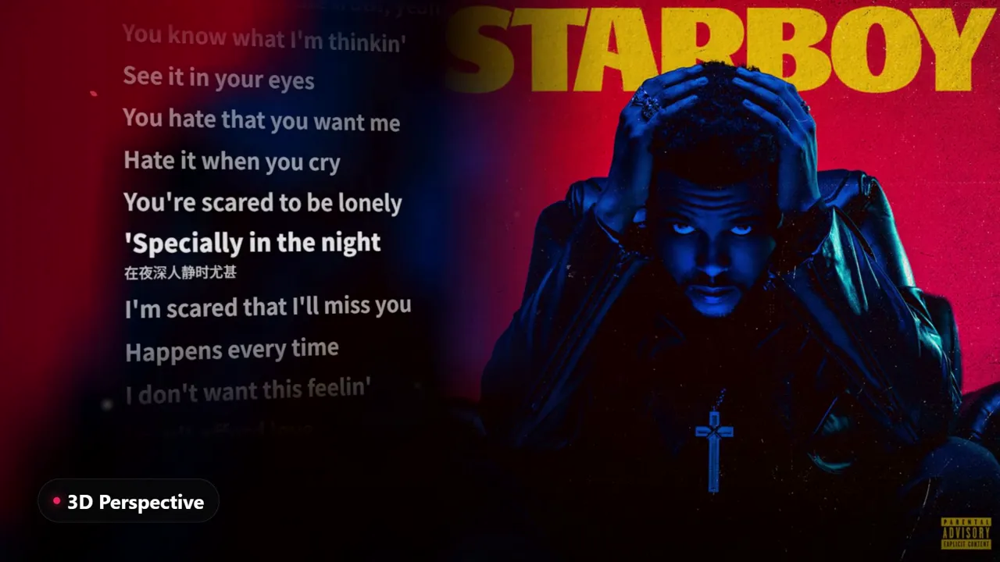</a>

</div>

## Features

- **Nine lyric stages.** Words light up as they are sung, with translations under each line. Switch styles any time while a song plays.
- **Share lyrics.** Pick 1-4 lines and turn them into a story-sized card in the cover's colours.
- **Search by lyrics.** Remember only one line? Search it.
- **Daily Mix and Personal FM.** A new playlist every morning, picked by LyriStage's own recommendation engine from your listening. Dislike a song on FM and you'll hear fewer like it. No NetEase account needed.
- **Listening report and Year in Review.** Your month or year in music, plus a story-style year in review with your song of the year and the lyric you heard most. Every page can be shared as an image.
- **Song radio.** Start a station from any song: similar songs, ranked by your taste.
- **Listen Together.** Open a room, share the six-letter code, and everyone hears the same song at the same moment. Chat, send reactions, and hand the room to someone else.
- **Friends.** Add friends with a code (they approve it) and see what they're listening to. A weekly board shows who listened most and everyone's top artist. Turn sharing off or use a private session any time.
- **Shared playlists.** Invite others to add songs; each song shows who added it.
- **Queue and sleep timer.** Play next, add to queue, drag to reorder, or see the whole queue as a poster wall of covers; stop after 15/30/60 minutes or at the end of the song.
- **Equalizer.** 10 bands with presets, plus volume leveling so every song plays at about the same loudness.
- **Your own library.** Likes, playlists, listening history, profile name and photo, synced between PC and phone. Export your data or delete your account from Settings.
- **Windows.** Tray icon, desktop lyrics while the app is minimized, global shortcuts, automatic updates, a 3D figurine on the home page.
- **Android.** Background playback, lock-screen and notification controls, lyrics on the lock screen, a home screen widget with the line being sung, full-screen lyrics in landscape.
- **iPhone.** A web app you can add to the Home Screen.
- **中文 / English**, light and dark themes.

LyriStage is **invite-only** for now. Anyone can look around; playing music, likes and playlists need an account with an invite code from a member.

## Lyric stages

| | | |
|:-:|:-:|:-:|
| 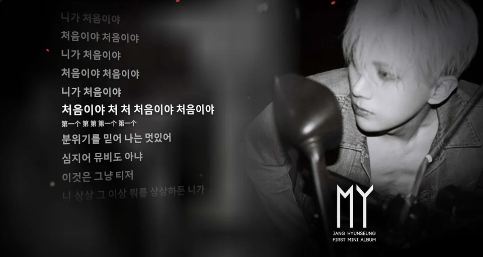<br>**3D Perspective**<br>Sharp cover art behind tilted 3D lyrics | 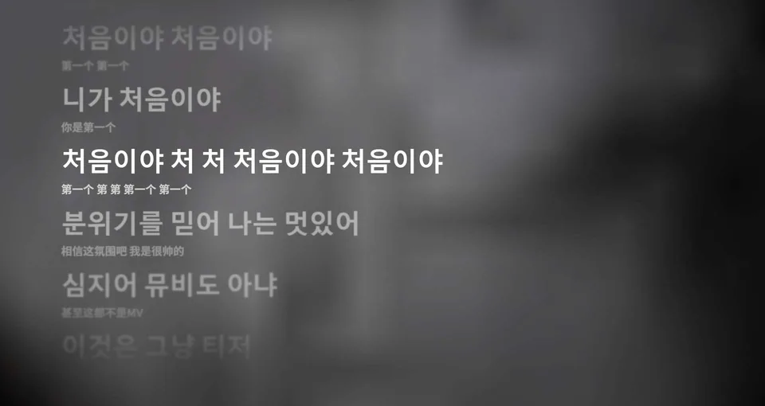<br>**Scrolling**<br>Word-by-word highlight over flowing cover colors | 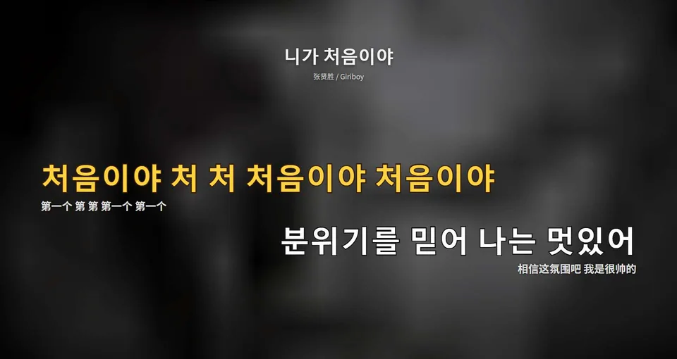<br>**Karaoke**<br>KTV-style alternating lines |
| 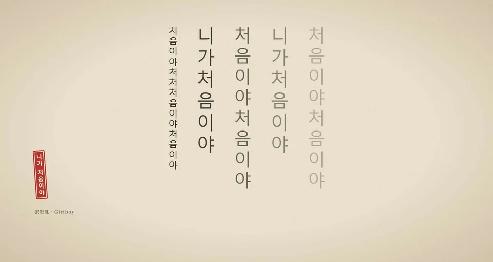<br>**Vertical Poetry**<br>Calligraphy on rice paper, with a red seal | 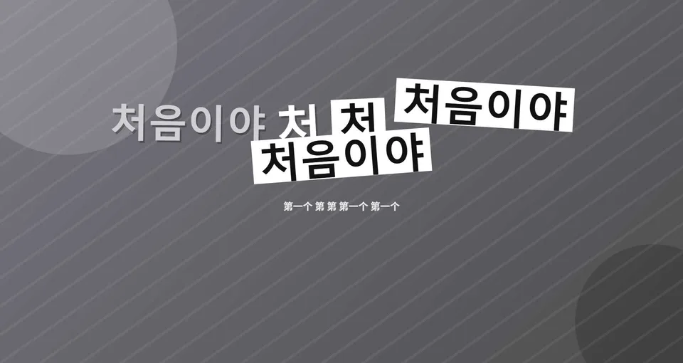<br>**Music Video**<br>Each phrase pops in with its own size, angle and color | 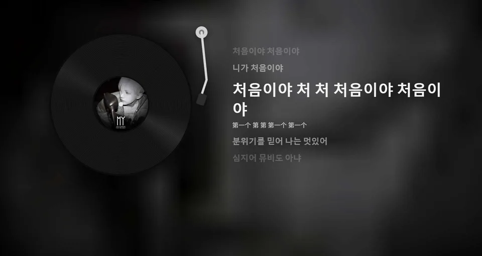<br>**Vinyl**<br>A spinning record and tonearm |
| 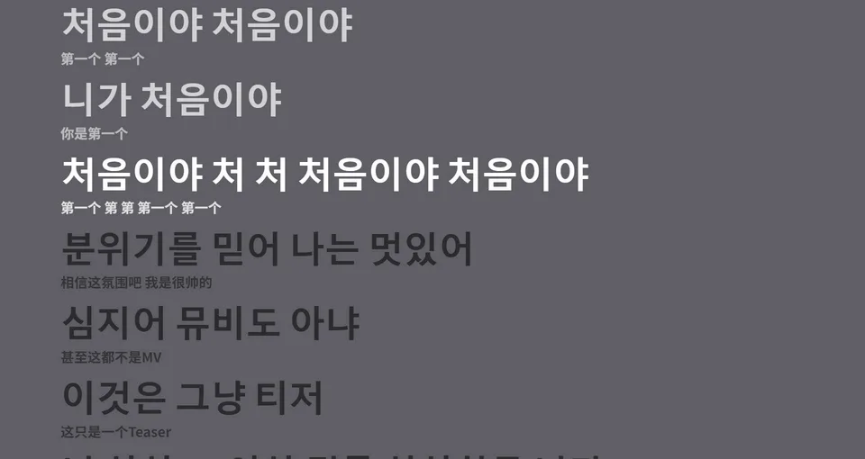<br>**Color Block**<br>The cover's main color with big bold text | 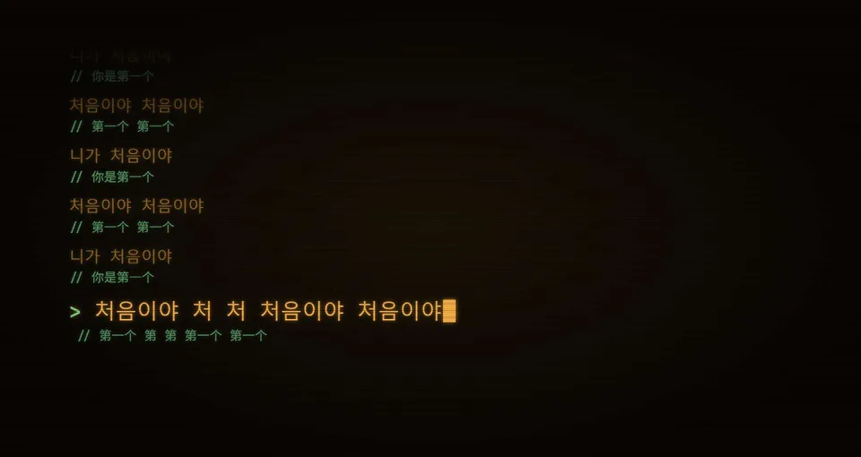<br>**Typewriter**<br>A retro terminal that types each word | 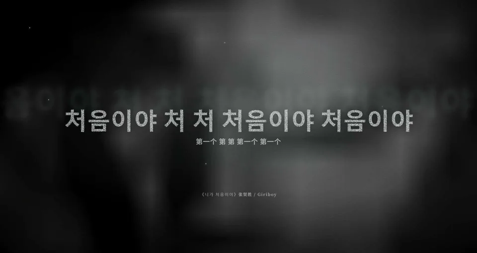<br>**Big Line**<br>One line at a time in huge distressed type |

## Screenshots

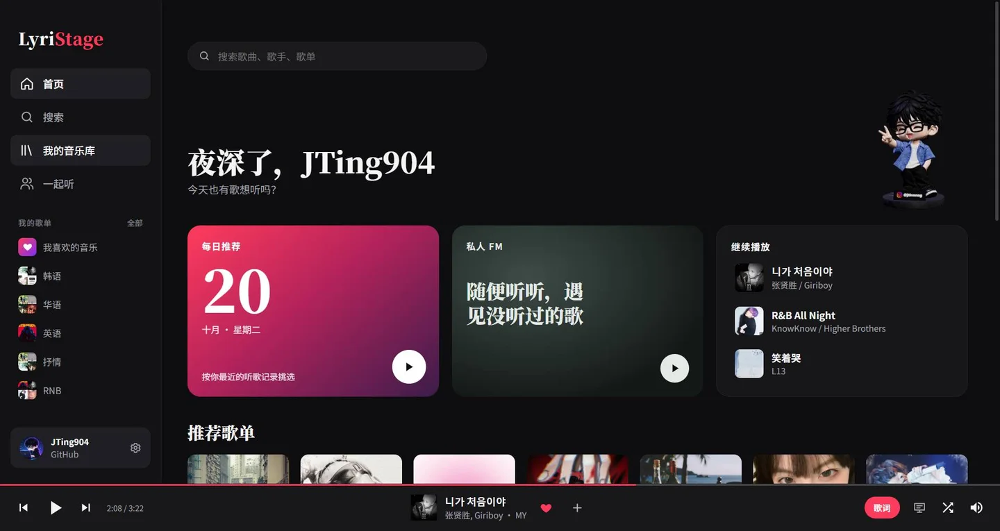 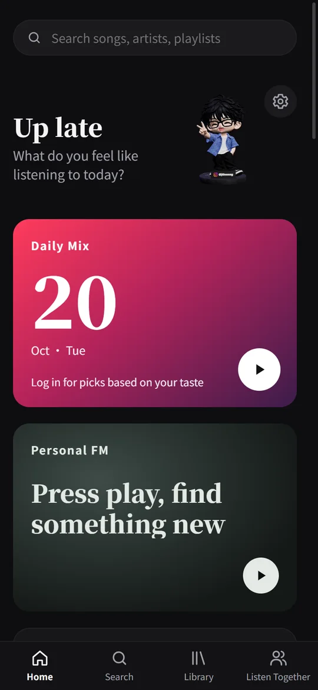 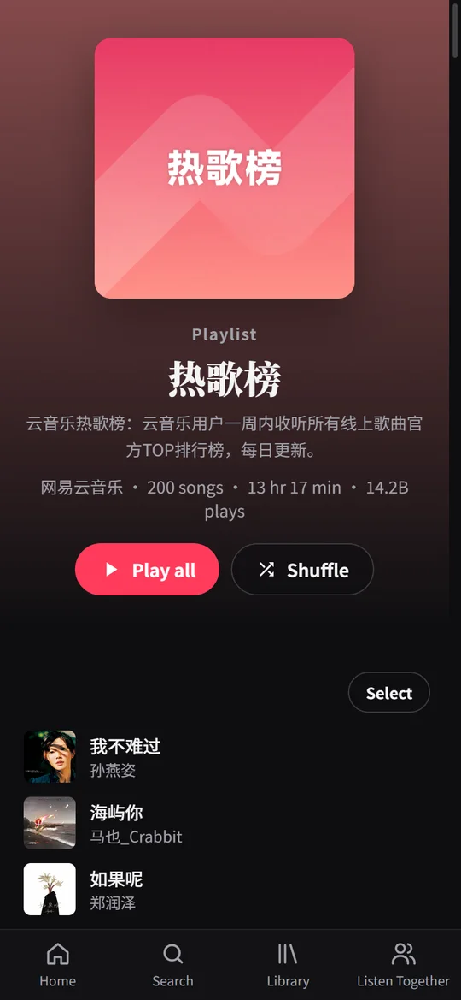

## Download

| Platform | How |
|---|---|
| Windows 10 / 11 (64-bit) | [LyriStage-Setup.exe](https://github.com/JTing904/LyriStage/releases/latest/download/LyriStage-Setup.exe). The installer isn't code-signed yet, so SmartScreen may warn you: **More info → Run anyway**. |
| Android 7.0+ | [LyriStage.apk](https://github.com/JTing904/LyriStage/releases/latest/download/LyriStage.apk). Allow your browser to install apps when asked. |
| iPhone | Open [lyristage.vercel.app](https://lyristage.vercel.app) in Safari, then **Share → Add to Home Screen**. |

## How it works

| Part | Built with |
|---|---|
| App (desktop, Android and web share one UI) | Vue 3, Pinia, Vue Router, vue-i18n, three.js |
| Desktop | Electron + electron-vite, electron-builder (NSIS installer) |
| Android | Capacitor |
| Accounts and user data | Supabase: Auth (email, GitHub, Google), Postgres with row-level security, Realtime (Listen Together), Storage (avatars) |
| Music API for the web app and Android | A NetEase Cloud Music API server on Vercel, open to members only |
| Tests | Vitest |

Song information, audio and lyrics come from NetEase Cloud Music through the community API. Your likes, playlists, history, daily mix and FM live in LyriStage's own Supabase database, so no NetEase account is involved.

```
src/main/       Electron main process: windows, tray, desktop lyrics, local music API
src/preload/    Bridge between the page and Electron (window.lyristage)
src/renderer/   Vue UI, shared by desktop, Android and web
src/core/       UI-independent logic: requests, NetEase API, lyrics, user data, recommendations
server/         The music API deployed to Vercel (checks membership before every request)
supabase/       Database migrations
android/        Capacitor Android project
```

## Development

You need Node.js (developed on 24) and, for Android, Android Studio.

```bash
npm install
cp .env.example .env      # then fill in your Supabase URL and anon key

npm run dev               # desktop app; starts a local music API on 127.0.0.1:10754
npm test                  # unit tests

npm run api:dev           # web: local music API on port 3001
npm run web:dev           # web: http://localhost:5173 (phones on the same Wi-Fi can open it too)
```

If Electron fails with `Cannot read properties of undefined` inside VS Code, the terminal inherited `ELECTRON_RUN_AS_NODE=1`. Start it with `env -u ELECTRON_RUN_AS_NODE npm run dev`.

### Your own backend

1. Create a [Supabase](https://supabase.com) project.
2. In the SQL Editor, run the files in [supabase/migrations](supabase/migrations) in order:
   `init` (user data), `invites` (invite-only access), `listen_together`, `avatars`,
   `security` (host-only broadcast in rooms, safer invite codes), `room_chat` and `room_chat_fix` (Listen Together chat),
   `room_handover`, `delete_account` (delete your account from Settings), `bilibili_picks` and `bilibili_picks_grant`,
   `friends_and_shared_playlists` and `playlist_people_profiles`, `history_compaction` (monthly clean-up of old history;
   needs the `pg_cron` extension), `slim_play_history`, `friends_weekly_board`, `storage_usage_all_databases`,
   `playlist_covers`, `archive_old_history` (moves history older than two years to File storage every month), `archive_secret_hash`, `stage_backgrounds` (your own photo behind the lyrics).
   For that last one, deploy [supabase/functions/archive-history](supabase/functions/archive-history) as an Edge Function
   with JWT verification off, then run the `archive_function_url` line at the bottom of the SQL file with your project ref.
3. Authentication → Providers: enable Email (and GitHub / Google if you want them).
   Under URL Configuration add `lyristage://auth/callback` (desktop sign-in) and `http://localhost:5173/**` (web dev) to Redirect URLs.
4. Put the project URL and anon key in `.env` (`VITE_SUPABASE_URL`, `VITE_SUPABASE_ANON_KEY`).
5. Deploy `server/` to Vercel with the environment variables `SUPABASE_URL` and `SUPABASE_ANON_KEY`, and point `VITE_API_BASE` in `.env.web` and `.env.app` at it.

Invite codes are made in the app under **Settings → Invite friends** (admins only), or in the SQL Editor:

```sql
select public.create_invite();              -- one-time code
select public.create_invite(5, 'classmates'); -- code that works 5 times
update public.members set is_admin = true where user_id = '…';  -- make someone an admin
```

### Building

```bash
npm run dist:win     # Windows installer in release/
npm run app:apk      # Android debug APK
npm run web:deploy   # web app to Vercel
```

Release APKs are signed with a keystore described in `android/keystore.properties` (`storeFile`, `storePassword`, `keyAlias`, `keyPassword`). That file is not in the repository; without it you can only build debug APKs.

## License

- **Code:** [MIT](LICENSE).
- **3D figurine models** (`src/renderer/public/models/`): © JTing904, all rights reserved. They are **not** covered by the MIT license. Don't reuse or redistribute them. See [the models notice](src/renderer/public/models/NOTICE.md).

## Credits

- [YesPlayMusic](https://github.com/qier222/YesPlayMusic) by qier222 (MIT). LyriStage started as a fork; the original README is in [README.upstream.md](README.upstream.md).
- [NeteaseCloudMusicApi Enhanced](https://github.com/NeteaseCloudMusicApiEnhanced/api-enhanced) for the music API.
- [Supabase](https://supabase.com), [Electron](https://www.electronjs.org), [Capacitor](https://capacitorjs.com), [Vue](https://vuejs.org), [three.js](https://threejs.org).

## Disclaimer

LyriStage is a personal learning project. It is not affiliated with or endorsed by NetEase Cloud Music. Songs and lyrics belong to their copyright owners. Not for commercial use.

---

Made by [JTing904](https://github.com/JTing904) · Instagram [@jtinnnng](https://www.instagram.com/jtinnnng/)
